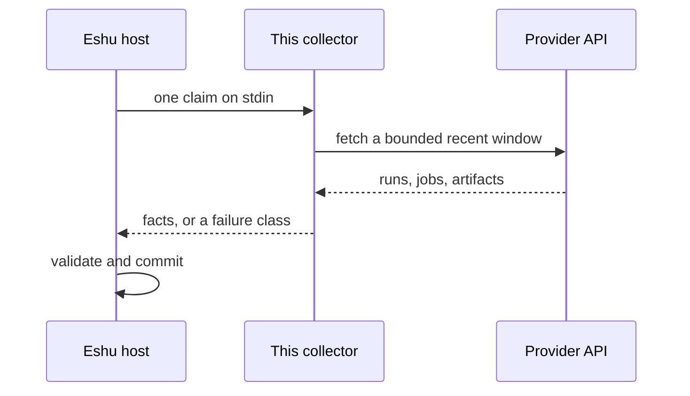

# Diagrams

Every diagram for this collector lives on this page, so we never end up with three slightly different copies of the same picture. Other pages link here instead of redrawing anything. Each picture comes with a plain-words version right underneath it, for screen readers and for anyone reading in a terminal.

## System context

Where this collector sits, and what it talks to.

In words: GitHub Actions or GitLab CI feed this collector, the collector hands its result to the Eshu host process, and the host passes checked facts on to Eshu core. The collector never talks to Eshu's database directly. Everything it knows leaves through that one result.

## Claim lifecycle

What happens between Eshu asking and Eshu storing.

In words: the host starts the collector for one claim and sends one bounded request on stdin. The collector does its one bounded read, turns the answer into facts (or into a failure class explaining why it couldn't), and writes one result to stdout. The host then validates and commits, and the collector process is done.

## Deployment and seed

How the binary gets from a published image into a component folder the host can run.

In words: the published image holds a single static binary and nothing else. Running it with `seed` copies that binary into the component folder as `collector` (mode 0755) and writes `manifest.yaml` beside it, stamping in the exact image reference when you pass one. After that, the Eshu host runs the seeded binary claim by claim, as shown in the lifecycle above.
